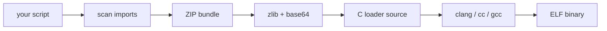

<div align="center">

# ZORA Builder

**Turn a Python script into a single native executable. Built for Termux on Android.**

[](https://github.com/djunekz/zorabuilder/actions/workflows/ci.yml)
[](https://github.com/djunekz/zorabuilder/releases)


[](LICENSE)

[](CONTRIBUTING.md)
[](CODE_OF_CONDUCT.md)

[Quick start](#quick-start) · [Installation](#installation) · [Usage](#usage) · [How it works](#how-it-works) · [Docs](#documentation) · [Contributing](#contributing)

</div>

---

```console
$ zorabuilder hello.py hello
✓ Build successful → hello

$ ./hello Termux
Hello, Termux!
```

## Table of contents

- [Why ZORA Builder](#why-zora-builder)
- [Quick start](#quick-start)
- [Installation](#installation)
- [Usage](#usage)
- [What gets bundled](#what-gets-bundled)
- [How it works](#how-it-works)
- [Limitations](#limitations)
- [Security notes](#security-notes)
- [Project structure](#project-structure)
- [Documentation](#documentation)
- [Development](#development)
- [Contributing](#contributing)
- [Community and support](#community-and-support)
- [License](#license)

## Why ZORA Builder

Sharing a Python script usually means "install Python, then run `python3 script.py`". ZORA Builder gives you a normal executable instead: `./myapp`.

- **One file out.** Your script and the modules it imports are packed into a single ELF binary.
- **Automatic dependency discovery.** Imports are found by reading your code. Local modules, packages and pure-Python third-party libraries are included for you.
- **Small.** The loader is about 18 KB; your compressed code is added on top.
- **Zero runtime dependencies.** The builder uses only the Python standard library. All you need is a C compiler.
- **Made for the phone.** Works in Termux, fits narrow screens, and every message is readable without colors.
- **Honest and predictable.** Stable exit codes, errors on stderr, deterministic bundles, a JSON build report, and clear documentation of what it cannot do.
- **Your arguments stay yours.** `./myapp -h`, `--version` and `-c` reach *your* script, not the Python interpreter.

## Quick start

```bash
pkg install python clang zlib
curl -fsSL https://raw.githubusercontent.com/djunekz/zorabuilder/main/install.sh | bash
```

Write a script, `hello.py`:

```python
import sys

print(f"Hello, {sys.argv[1] if len(sys.argv) > 1 else 'world'}!")
```

Build and run it:

```bash
zorabuilder hello.py hello
./hello Termux
```

The command is always `zorabuilder script output [options]`.

## Installation

### Requirements

| Needed | Termux | Debian / Ubuntu |
| ------ | ------ | --------------- |
| Python 3.10+ with headers | `pkg install python` | `sudo apt-get install python3 python3-dev` |
| A C compiler | `pkg install clang` | `sudo apt-get install gcc` |
| zlib headers | `pkg install zlib` | `sudo apt-get install zlib1g-dev` |
| UPX (optional, for `--upx`) | `pkg install upx` | `sudo apt-get install upx-ucl` |

### Option 1: installer script (recommended)

```bash
curl -fsSL https://raw.githubusercontent.com/djunekz/zorabuilder/main/install.sh | bash
```

The installer installs the system packages above (skip with `--no-deps`), copies ZORA Builder to `$PREFIX/share/zorabuilder` (Termux) or `~/.local/share/zorabuilder`, and creates the `zorabuilder` and `zora` commands.

Useful options:

```bash
./install.sh --help
./install.sh --prefix ~/tools --no-deps
./install.sh --with-upx
./install.sh --ref v2.1.0
```

Prefer to read before you run? Download the script, inspect it, then run it:

```bash
curl -fsSLO https://raw.githubusercontent.com/djunekz/zorabuilder/main/install.sh
less install.sh
bash install.sh
```

### Option 2: from a checkout

```bash
git clone https://github.com/djunekz/zorabuilder.git
cd zorabuilder
./install.sh
```

Or run it without installing:

```bash
python3 zorabuilder.py script.py output
```

### Option 3: pip

```bash
git clone https://github.com/djunekz/zorabuilder.git
cd zorabuilder
python3 -m pip install .
```

### Verify a release download

Each [release](https://github.com/djunekz/zorabuilder/releases) has two assets: the source archive and its checksum. Download both, check, then install:

```bash
VERSION=v2.1.1
BASE=https://github.com/djunekz/zorabuilder/releases/download/$VERSION
curl -fsSLO "$BASE/zorabuilder-$VERSION.tar.gz"
curl -fsSLO "$BASE/zorabuilder-$VERSION.tar.gz.sha256sum"
sha256sum -c "zorabuilder-$VERSION.tar.gz.sha256sum"
tar -xzf "zorabuilder-$VERSION.tar.gz"
cd "zorabuilder-$VERSION" && ./install.sh
```

`sha256sum -c` prints `OK` when the archive matches. If it prints `FAILED`, do not use the file.

### Uninstall

```bash
./uninstall.sh
```

This removes only what the installer created. System packages and the binaries you built are never touched. Add `--yes` to skip the confirmation.

## Usage

```text
zorabuilder script output [options]
```

| Argument | Meaning |
| -------- | ------- |
| `script` | Your entry Python script |
| `output` | The binary to create |

### Examples

```bash
zorabuilder myapp.py myapp
zorabuilder myapp.py myapp --isolated --upx
zorabuilder tool.py bin/tool --extra yaml,requests
zorabuilder tool.py tool --no-bundle --json-report build.json
zorabuilder myapp.py myapp --no-optimize --verbose
```

Ready-made programs to try are in [`examples/`](examples).

### Options

| Option | Description |
| ------ | ----------- |
| `--no-bundle` | Bundle only the script, no dependency modules |
| `--extra MODULES` | Force-include modules (comma-separated), including standard library modules |
| `--isolated` | Ignore `site-packages` and `PYTHON*` environment variables at runtime |
| `--no-optimize` | Faster build: `-O1` instead of `-O3 -flto` |
| `--compress-level 0-9` | zlib compression level (default 9) |
| `--cc COMPILER` | Choose the compiler (default: auto-detect clang, cc, gcc) |
| `--static` | Try a static link, fall back to dynamic (experimental) |
| `--upx` | Compress the final binary with UPX |
| `--keep-c` | Keep the generated C source as `<output>.c` |
| `--json-report FILE` | Write a machine-readable build report |
| `--verbose` | Show modules the scanner could not find |
| `--no-banner` | Print a one-line title instead of the ASCII banner |
| `--version` | Show the version |
| `-h`, `--help` | Show help |

Environment variables: `NO_COLOR` disables colors, `ZORA_NO_BANNER=1` disables the banner.

<details>
<summary>Full <code>--help</code> output</summary>

```text
usage: zorabuilder script output [options]

Bundle a Python script into a standalone ELF binary (Termux/Android).

arguments:
  script                entry Python script (e.g. myapp.py)
  output                binary file to create (e.g. myapp)

build options:
  --no-bundle           bundle only the script, skip dependency modules
  --extra MODULES       comma-separated modules to force-include (e.g.
                        yaml,requests)
  --isolated            ignore site-packages and PYTHON* env vars at runtime
  --no-optimize         faster build: use -O1 instead of -O3 -flto
  --compress-level 0-9  zlib compression level (default: 9)
  --cc COMPILER         C compiler to use (default: auto-detect
                        clang/cc/gcc)
  --static              try a static link, fall back to dynamic
                        (experimental)
  --upx                 compress the final binary with UPX

output options:
  --keep-c              keep the generated C source as <output>.c
  --json-report FILE    write a machine-readable build report to FILE
  --verbose             show modules the scanner could not find
  --no-banner           print a one-line title instead of the ASCII banner
                        (env: ZORA_NO_BANNER)

other:
  -h, --help            show this help message and exit
  --version             show program's version number and exit

examples:
  zorabuilder myapp.py myapp
  zorabuilder myapp.py myapp --isolated --upx
  zorabuilder tool.py bin/tool --extra yaml,requests
  zorabuilder tool.py tool --no-bundle --json-report build.json
```

</details>

### A real build

```text
ℹ Entry script: hello.py
⟳ Scanning imports...
ℹ Found 1 bundleable module(s)
⟳ Building ZIP bundle...
◈   + __main__.py (93 bytes)
◈   + mod: helper.py (42 bytes)
ℹ Bundle size: 349 bytes (1 modules)
⟳ Compressing + encoding bundle...
⟳ Generating C loader...
⟳ Compiler: cc
⟳ Running build (O3+LTO)...
✓ Build successful → hello

  BUILD REPORT
Input:          hello.py
Output:         hello
Modules:        1

Sizes:
  Script only:            93 bytes
  Bundle (zip):          349 bytes
  Final binary:       18,560 bytes

Binary:
  SHA256:         5e46bbcd51d9d666bc87d76507d6e77fa36bbe2889064df5aa2adedc27c2e80d

Run: ./hello [args]
```

For the full guide, including the JSON report format, CI use and distribution tips, see [docs/USAGE.md](docs/USAGE.md).

## What gets bundled

| Kind | Bundled? |
| ---- | :------: |
| Your entry script | Yes |
| Local modules and packages next to it | Yes |
| Pure-Python third-party packages installed for the builder's Python | Yes |
| Standard library | No, loaded from the Python installation (force with `--extra`) |
| C extension modules (`.so`, e.g. NumPy) | No (warning shown) |
| Data files (JSON, images, templates) | No |
| `test` / `tests` folders inside packages | Skipped |

Imports are found statically. For `__import__("name")`, `importlib.import_module(variable)` and plugin systems, add the modules with `--extra`.

## How it works



1. **Scan.** The builder reads your script's imports (and theirs, recursively) and finds the files.
2. **Bundle.** Everything goes into a deterministic ZIP, compressed once with zlib and base64-encoded.
3. **Generate and compile.** The payload is embedded in a small C program that is compiled against your Python.
4. **Run.** At startup the binary unpacks the bundle to a private temporary file, starts the local Python interpreter with your arguments untouched, runs your `__main__`, then removes the file.

ZORA Builder does **not** compile Python to machine code. Your program runs on the regular interpreter, so speed and behavior match `python3 script.py`. Details, diagrams and design decisions are in [docs/ARCHITECTURE.md](docs/ARCHITECTURE.md).

## Limitations

Read this before you depend on it.

| Good fit | Not a good fit |
| -------- | -------------- |
| Scripts and CLI tools for your own Termux or Linux device | Shipping to machines without a matching Python |
| Sharing a tool among devices with the same Python and CPU | Hiding source code or secrets |
| Quick, dependency-free packaging | Bundling compiled packages (NumPy, Pillow, ...) |
| Learning how embedding Python works | Windows or macOS executables |

- The binary needs the **same Python installation** it was built with (`libpythonX.Y.so`, the standard library, extension modules). Rebuild after upgrading Python.
- The bundle is **not encrypted**; anyone can recover your source from the binary.
- Only `.py` files are bundled. `__file__` points at a temporary file; use `/proc/self/exe` to find the binary.
- `--static` is experimental and falls back to a dynamic link on most systems.
- Build on the device that will run the binary: no cross-compilation.

More in the [FAQ](docs/FAQ.md) and [troubleshooting guide](docs/TROUBLESHOOTING.md).

## Security notes

- Never put passwords, tokens or keys in a script you bundle. The payload is compressed, not protected.
- The loader writes a temporary file with owner-only permissions and removes it on exit, on errors and on `SIGTERM`.
- Use `--isolated` for binaries you distribute so environment variables cannot change what they load.
- Build in a clean environment: whatever is installed for the builder ends up in your bundle.

Report vulnerabilities privately; see [SECURITY.md](SECURITY.md). The tool collects no data and makes no network connections; see [PRIVACY.md](PRIVACY.md).

## Project structure

```text
zorabuilder/
├── zorabuilder.py          entrypoint
├── core/                   the builder
│   ├── cli.py              arguments, validation, orchestration
│   ├── scanner.py          import discovery
│   ├── bundler.py          ZIP + compression
│   ├── codegen.py          C loader template
│   ├── compiler.py         clang/cc/gcc, linking, UPX
│   ├── report.py           text and JSON reports
│   ├── config.py           BuildConfig
│   └── ui.py               colors, banner, logging
├── tests/                  unittest suite
├── examples/               small programs to try
├── docs/                   guides and references
├── scripts/                maintenance and device check scripts
├── install.sh              installer
├── uninstall.sh            uninstaller
├── LICENSE                 MIT license
└── .github/                issue forms, PR template, workflows
```

## Documentation

| Document | Description |
| -------- | ----------- |
| [Usage guide](docs/USAGE.md) | Step-by-step guide, every option, JSON report, CI |
| [Troubleshooting](docs/TROUBLESHOOTING.md) | Error messages and fixes |
| [FAQ](docs/FAQ.md) | What it is, what it is not |
| [Architecture](docs/ARCHITECTURE.md) | Internals, diagrams, design decisions |
| [Development](docs/DEVELOPMENT.md) | Environment, debugging, conventions |
| [Testing](docs/TESTING.md) | Test suite and CI |
| [Releasing](docs/RELEASING.md) | Release process |
| [Roadmap](docs/ROADMAP.md) | Ideas and non-goals |
| [Changelog](CHANGELOG.md) | What changed in each version |
| [Accessibility](ACCESSIBILITY.md) | Using the tool with assistive technology |
| [Governance](GOVERNANCE.md) | How decisions are made |

## Development

```bash
git clone https://github.com/djunekz/zorabuilder.git
cd zorabuilder
python3 -m pip install -r requirements-dev.txt
python3 -m unittest discover -s tests -t . -v
ruff check .
```

The suite includes real end-to-end builds and signal handling tests. To check a real device (Termux included), run `./scripts/termux-check.sh`. See [docs/DEVELOPMENT.md](docs/DEVELOPMENT.md) and [docs/TESTING.md](docs/TESTING.md).

## Contributing

Contributions of every size are welcome: bug reports, build failures from your device, documentation fixes, tests and code.

1. Read [CONTRIBUTING.md](CONTRIBUTING.md)
2. Pick or open an [issue](https://github.com/djunekz/zorabuilder/issues/new/choose)
3. Fork, branch, and open a pull request

Looking for a first task? Search for [`good first issue`](https://github.com/djunekz/zorabuilder/labels/good%20first%20issue).

## Community and support

- Questions and help: [SUPPORT.md](SUPPORT.md)
- Be kind: [Code of Conduct](CODE_OF_CONDUCT.md)
- Security reports: [SECURITY.md](SECURITY.md)
- Maintainer: [@djunekz](https://github.com/djunekz)

## License

ZORA Builder is released under the [MIT License](LICENSE). Copyright (c) 2026 djunekz.

Programs you build with it contain your own code and the third-party modules you bundle, plus the Python runtime they load. Their licenses apply to your binaries; check them before you distribute.
