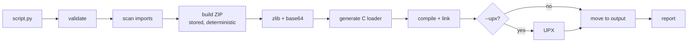
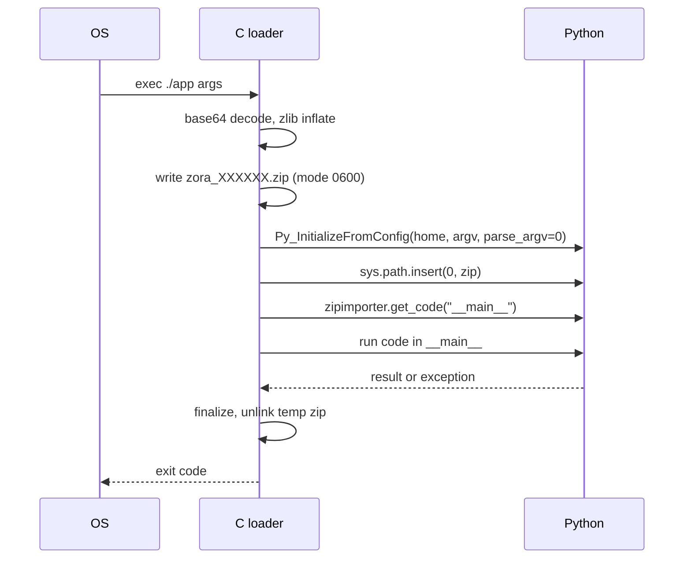

# Architecture

This document explains how ZORA Builder works: the builder (the Python program you run) and the binary it produces.

## Overview

ZORA Builder does **not** translate Python into machine code. It produces a small native program, the *loader*, that embeds your Python code as a compressed payload and starts the Python interpreter from the local installation to run it.

```text
 your script + imports            native ELF binary
┌─────────────────────┐        ┌──────────────────────────┐
│ app.py              │        │ C loader (compiled)       │
│ helper.py           │  ───►  │  + payload: base64(zlib(  │
│ mypkg/...           │        │      ZIP of your modules))│
└─────────────────────┘        └──────────────────────────┘
                                   needs at runtime:
                                   libpythonX.Y.so + stdlib
```

## Build pipeline



| Stage | Module | What happens |
| ----- | ------ | ------------ |
| Parse arguments | `core/cli.py` | argparse builds a `BuildConfig`. No arguments prints help. |
| Validate | `core/cli.py` | Script exists and parses; output is not the input, not a directory, and its folder exists. |
| Scan | `core/scanner.py` | Walks the AST of the entry script and of every module it finds, collecting import names, and resolves them to files on disk. |
| Bundle | `core/bundler.py` | Writes `__main__.py` plus the discovered modules into an in-memory ZIP, then compresses it with zlib and encodes it as base64. |
| Generate | `core/codegen.py` | Fills the C template with the payload, the exact ZIP size, the Python prefix and the isolated-mode block. |
| Compile | `core/compiler.py` | Runs clang, cc or gcc against the Python headers and `libpython`, into a temporary directory. |
| Finish | `core/compiler.py`, `core/report.py` | Optionally runs UPX, moves the result to the output path, marks it executable, prints the report. |

### Module map

```text
zorabuilder.py        entrypoint; puts its own folder on sys.path and calls core.cli.main
core/
├── cli.py            argument parsing, validation, orchestration, exit codes
├── config.py         BuildConfig dataclass shared by all stages
├── scanner.py        import discovery and module resolution
├── bundler.py        ZIP building, compression, encoding
├── codegen.py        C template and substitution
├── compiler.py       toolchain detection, flags, linking, UPX
├── report.py         text report, SHA-256, JSON report
└── ui.py             colors, banner, log lines, die()
```

Dependencies only point downward: `cli` uses everything; `scanner` and `bundler` share `iter_package_files`; `ui` is used by all and uses nothing.

## The scanner

The scanner decides what goes into the bundle.

1. Parse the entry script with `ast` and collect top-level names from `import x` and `from x import y` statements, **including those inside functions and `try` blocks**. Relative imports (`from . import z`) are skipped, because the whole package is bundled anyway.
2. For each name, find a path:
   - A module or package in the **entry script's folder** wins first (this also protects against name clashes such as a local `core.py`).
   - Otherwise `importlib.util.find_spec`, including namespace packages.
3. Skip names that are built-in or part of the standard library (`sys.builtin_module_names`, `sys.stdlib_module_names`), unless they are forced with `--extra` or shadowed by a local module. The standard library is loaded from the Python installation at runtime.
4. Single files are added to the bundle and scanned for further imports. Packages are walked recursively (`*.py`), skipping `__pycache__`, `tests`, `test`, `.git` and `*.dist-info` / `*.egg-info` folders **relative to the package root**.
5. Extension modules (`.so`, `.pyd`, `.dylib`) cannot be bundled. A warning is shown, and packages that contain them produce a warning too.
6. Repeat until no new names appear. The scanner temporarily adds the entry script's folder to `sys.path` and restores it afterwards.

Limits: only static imports are detected. `__import__("x")`, `importlib.import_module(var)` and plugin loading need `--extra`. Non-Python data files (JSON, templates, images) are not bundled.

## The payload

```text
base64( zlib.compress( ZIP_STORED archive ) )
```

- The archive contains `__main__.py` (your entry script, unchanged) and the modules by their import path (`helper.py`, `mypkg/__init__.py`, ...).
- Entries use `ZIP_STORED` with a fixed timestamp and are written in sorted order, so the same inputs always give the same bytes. Compression is applied once, around the whole archive, which also lets zlib exploit similarity between files.
- The exact uncompressed size is embedded as a C constant, so the loader allocates one buffer and can detect truncation or corruption.
- The base64 text is split into 4000-character string literals to keep the C source friendly to compilers.

## The generated binary

### Startup sequence



### Key behaviors

| Behavior | Why |
| -------- | --- |
| `config.parse_argv = 0` | Without it Python treats `./app -h` or `./app -c` as interpreter options and corrupts `sys.argv`. With it, your program sees exactly the arguments it was started with. |
| `config.home` = prefix of the Python the builder used (`sys.base_prefix`) | The binary finds the standard library and extension modules the same way that Python did. |
| `--isolated` sets `site_import = 0`, `user_site_directory = 0`, `use_environment = 0` | The binary ignores `site-packages` and `PYTHON*` variables. |
| Bundle is written to a temp file | `zipimport` needs a real path. The file is created with `mkstemps` (owner-only), located in `$TMPDIR`, else `<prefix>/tmp`, else `/tmp`. |
| Cleanup via `atexit`, plus signal handling | The temp file is removed on normal exit, on uncaught exceptions and on `SIGTERM`. The loader handles `SIGINT` only until Python starts (it is blocked during interpreter init, then the original disposition is restored), so Python installs its own handler and Ctrl+C becomes a catchable `KeyboardInterrupt`. Signals that were inherited as ignored stay ignored. `SIGKILL` cannot be handled. |
| Errors go through `PyErr_Print` | `sys.exit(n)`, `sys.exit("message")`, tracebacks and `KeyboardInterrupt` behave like real Python, including exit codes. |
| `__file__` is the temp ZIP path, `__spec__` and `__loader__` are `None` | Code is executed directly in `__main__`. Tracebacks show the ZIP path. See the FAQ for how to find the binary's location. |

### Exit codes

Builder (`zorabuilder`):

| Code | Meaning |
| ---- | ------- |
| 0 | Success |
| 1 | Validation error, missing toolchain, compilation failure, or any other build error |
| 2 | Invalid command-line usage |
| 130 | Interrupted with Ctrl+C |

Built binary:

| Code | Meaning |
| ---- | ------- |
| your program's | Whatever your script exits with (`sys.exit(n)`, 0 on normal end) |
| 1 | Uncaught exception, or a loader error (decode, decompress, temp file, interpreter init, missing `__main__`) |
| 130 | Uncaught `KeyboardInterrupt` (Ctrl+C) |
| 120 | Interpreter finalization failed |
| 143 | Terminated by `SIGTERM` (the temp file is removed first) |

## Compilation

```text
cc zora_main.c  -O3 -flto  -fPIC -pie -s
   -ffunction-sections -fdata-sections -Wl,--gc-sections
   -I<include> -L<libdir> -Wl,-rpath,<libdir>
   -lpythonX.Y -lz  -o <temp>/zora_out
```

- `--no-optimize` replaces `-O3 -flto` with `-O1` for faster builds.
- `--static` replaces the rpath with `-static`. If linking fails, the builder warns and retries dynamically. Static linking is experimental: extension modules from `lib-dynload` cannot load into a static binary.
- Paths come from `sysconfig` (`include`, `LIBDIR`, `LDVERSION`, which handles ABI flag suffixes), with fallbacks derived from `sys.base_prefix`.
- Output is built inside a temporary directory and moved to the destination only on success, so a failed build never leaves a half-written binary. The temp directory is always removed.
- With `--keep-c`, the generated source is copied to `<output>.c` **before** compiling, so it is available even if compilation fails.

## Design decisions

**Why not embed the standard library?** The binary links `libpython` dynamically from the local installation, so the standard library is always there. Bundling it again would grow every binary by megabytes (a 200-byte script produced a 2.3 MB bundle) without making it more portable.

**Why a temp file instead of loading from memory?** `zipimport` works on paths. A temp file is portable across Linux and Android. Loading from memory (for example via `memfd_create`) is on the [roadmap](ROADMAP.md).

**Why a ZIP and not individual embedded files?** Python can import from a ZIP natively, keeping the loader small and the import semantics (packages, relative imports) intact.

**Why zlib around a stored ZIP, not a deflated ZIP?** Compressing twice wastes CPU and compresses worse. One zlib pass over the whole archive is simpler, smaller and deterministic.

**Why no runtime dependencies?** The builder is meant to run in a minimal Termux environment. Standard library only means nothing to install and nothing to break.

**Why is the scanner static?** Executing the user's code to discover imports would be unsafe and slow. Static analysis is predictable, with `--extra` as the escape hatch.

## Extension points

| Goal | Where |
| ---- | ----- |
| New CLI option | Add it in `build_arg_parser`, map it in `config_from_args`, add a `BuildConfig` field, use it in `run`. Update README, `docs/USAGE.md`, CHANGELOG and tests. |
| Change runtime behavior | Edit `C_TEMPLATE` in `core/codegen.py`. The tests compile the template with `-Wall -Wextra`; run the end-to-end tests too. |
| Support another toolchain flag | `core/compiler.py`, `build_elf` |
| Bundle more file types | `core/scanner.py` (`iter_package_files`) and `core/bundler.py` |
| Extra report fields | `core/report.py` and the JSON dict in `cli.run` |
